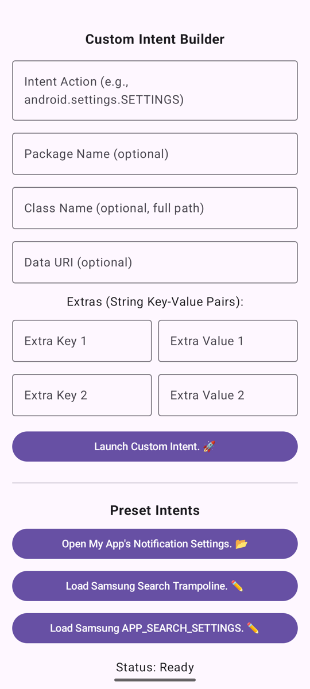
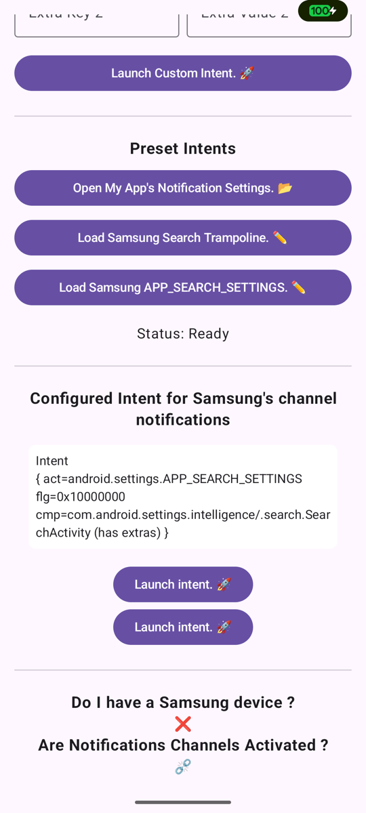

# Samsung Intent Notifications

An Android (Kotlin + Jetpack Compose) playground for firing arbitrary Android intents, built to explore Samsung's
notification-category settings screens.





## What it does

- **Custom intent builder**: set an action, optional package and class (component), an optional data URI, and up to two
  string extras, then launch the resulting intent with `FLAG_ACTIVITY_NEW_TASK`.
- **Preset intents**:
  - open this app's own notification settings;
  - load the Samsung search trampoline (`com.android.settings.search.SearchResultTrampoline`) into the form;
  - load `android.settings.APP_SEARCH_SETTINGS` targeting `com.android.settings.intelligence`, and launch it with the
    query "show notification category".
- **Device checks**: shows whether the manufacturer is Samsung, and whether the Samsung setting
  `show_notification_category_setting` is enabled (read from `Settings.Secure`).
- **Status line** reporting the outcome of each launch (success, missing action or component, activity not found).

## Limitations

- The Samsung-specific intents only resolve on Samsung devices with Settings Intelligence. On other devices the app shows
  its error toast/status instead. The screenshots above were taken on a non-Samsung emulator, so they show the UI only.
- The Samsung component names and the `Settings.Secure` key are not public APIs and may change between One UI versions.
- The unit and instrumented test files are the Android Studio template placeholders; there are no real tests yet.

## Tech stack

- Kotlin 2.0.21, Android Gradle Plugin 8.9.2, Gradle 8.11.1
- Jetpack Compose with Material 3 (Compose BOM 2024.09.00)
- AndroidX Activity Compose, Lifecycle, core-ktx
- minSdk 29, targetSdk / compileSdk 35

## Getting started

Requirements: JDK 17 and the Android SDK (API 35).

```bash
git clone https://github.com/Goudurixx/SamsungIntentNotifications.git
cd SamsungIntentNotifications
echo "sdk.dir=/path/to/Android/sdk" > local.properties   # not committed
./gradlew assembleDebug
```

Install `app/build/outputs/apk/debug/app-debug.apk` on a device or emulator, or open the project in Android Studio and
run the `app` configuration.

## Project layout

- `app/src/main/java/com/goudurixx/intents/MainActivity.kt`: the whole UI and intent logic (single screen).
- `app/src/main/java/com/goudurixx/intents/ui/theme/`: Compose theme (colors, typography).

## Status

Experimental. Built for personal exploration of Samsung settings intents.
